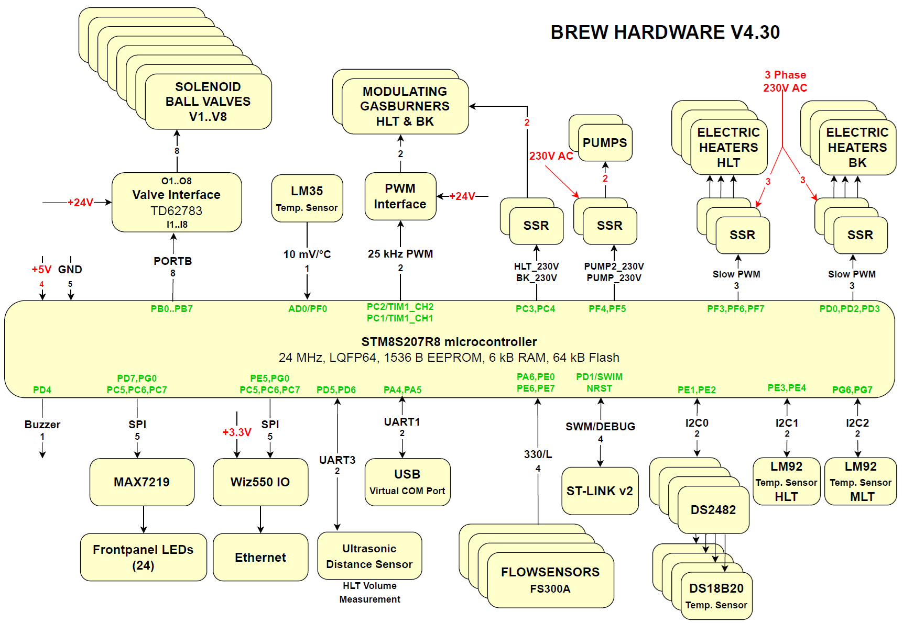
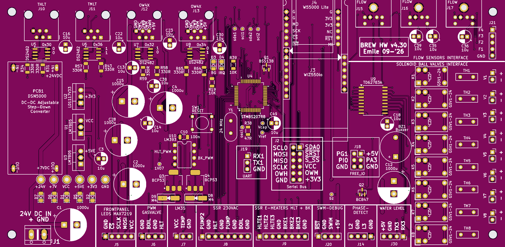
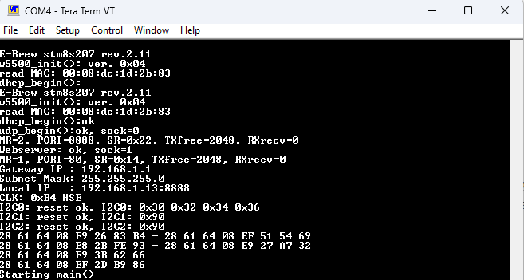

# Home-Brewery Automation
This repository contains the firmware for the STM8S207 microcontroller on the Brew hardware PCB. Its purpose is to automate a 3-vessel HERMS Brew-system. Such a brew-system contains a Hot Liquid Tun (HLT), a Mash-Lauter Tun (MLT) and a boil-kettle (BK).
There are also two pumps, eight valves, four flow-sensors and several temperature-sensors present. For heating there are both gas-burners and 3-phase electrical heating-elements present.

# Features
The current PCB and firmware have the following features:
- Reading of **6 x temperature sensors**: two in the HLT (one I2C LM92, one One-Wire DS18B20), one in the MLT (I2C), one in the boil-kettle (One-Wire), one at the output of the counterflow-chiller (One-Wire) and one at the MLT return-manifold (One-Wire).
- Reading of **one hardware temperature** by a LM35 temperature sensor: this is used to protect the Solid State Relays (SSR) from overheating. The LM35 is typically mounted to a heatsink of one of the SSRs that switch a heating-element.
- Reading a maximum of **4 x FS300A flowsensors**: between HLT and MLT, between MLT and boil-kettle, one at the output of the counterflow-chiller and one at the entry of the MLT return-manifold.
- Reading an ultrasonic distance sensor, that is used for accurate HLT volume measurements.
- Control of **8 x solenoid ball-valves** at 24 V DC. They are used to control liquid flow from and to all kettles.
- **2 x PWM signals (25 kHz, 24 V DC)** for the modulating gas burners (HLT and boil-kettle burners).
- Control of **4 x SSR outputs at 230 V AC**: the pump, a second pump (for the HLT counterflow-chiller), 230 V enable for the HLT gas burner and 230 V enable for the boil-kettle gas burner.
- Control of **6 x SSR outputs at 230 V AC** for the three phase heating-elements in the HLT and the boil-kettle. With this, heating of the HLT is possible with a gas-burner, with 1, 2 or 3 heating-elements of with any combination of these.
- **Synced SSR outputs** for HLT and boil-kettle, so that you only need **one three-phase connection**. The boil-kettle outputs have priority over the HLT outputs, meaning that if (on any phase of 230 V) both HLT and boil-kettle are heating, only the boil-kettle is activated.
  It is also possible to use just one (or two) of the three-phases, depending on the number of heating-elements inside the HLT and/or boil-kettle. The firmware is capable of addressing one, two or three heating-elements per kettle.
- **Ethernet and USB connection** to PC: USB-connection is used for debugging, main connection between PC-program and the firmware is Ethernet.
- **Frontpanel LEDs (27 in total)** that show the status of all actuators. They are controlled by a MAX7219 LED Display Driver, located on a separate PCB, the frontpanel PCB.

# Block Diagram
 
*Block-diagram of the hardware*

Abbreviations used:
- **BK**: Boil-kettle, one of the three brewing kettles in a HERMS configuration. Contains the wort that needs to be boiled.
- **HLT**: Hot Liquid Tun, one of the three brewing kettles in a HERMS configuration. Contains fresh water of a certain temperature.
- **MLT**: Mash-Lauter Tun, one of the three brewing kettles in a HERMS configuration. Contains the wort with the grains and typically has a filter inside to leave the grains inside the MLT.
- **I2C**: A digital interface between ICs, one of the most commonly used interfaces to connect ICs and sensors to a microcontroller.
- **One-Wire**: A digital interface between a sensor and a microcontroller, consisting of only one signal wire.
- **PWM**: Pulse Width Modulation, a signal representation that is used to control an actuator. It is a square-wave of which the duty-cycle is varied between 0 % and 100 %.
- **SPI**: a digital interface between ICs and a microcontroller. Together with the **I2C** interface, it is commonly found on a microcontroller.
- **SSR**: Solid State Relay, a device that switches 230 V AC and is controlled by a 5V signal from the microcontroller.

Integrated Circuits (IC) used:
- **STM8S207R8**: an 8-bits microcontroller from STM-microelectronics running on 24 MHz and has 64 kB Flash onboard. If has 56 free GPIO pins available.
- **TD62783**: an 8-channel high-voltage Source Driver, they can switch up to 50 V and 500 mA per channel. Used here the switch the solenoid ball-valves.
- **LM35**: a precision centigrade temperature sensor, delivering 10 mV per °C. The analog value is read in by one of the AD-converters of the STM8S207.
- **LM92**: a 12-bit + sign digital temperature sensor with I2C interface. They have a fixed I2C-address of 0x90 in the brewsystem.
- **DS18B20**: an One-Wire 12-bit digital temperature sensor.
- **DS2482**: an I2C to One-Wire bridge, connects to a microcontroller via the I2C interface and controls a One-Wire device, such as the DS18B20. They have addresses 0x30, 0x32, 0x34 and 0x36 in the brewsystem.
- **MAX7219**: a LED display-driver IC, capable of addressing 8 7-segment displays or 64 individual LEDs. It has an SPI-interface. The MAX7219 controls the 27 Frontpanel LEDs of the brewing hardware.
- **Wiz550IO**: an auto configurable Ethernet controller that includes a W5500 (TCP/IP hardwired chip and PHY embedded), a transformer and RJ45 connector.

More hardware and firmware design details: see my website: http://www.vandelogt.nl/uk_hardware.php. Note that the description there is still for the old hardware version, based around an Arduino Nano.

# Printed Circuit Board (PCB)
 
*Top view of v4.30 PCB, as made by JLCPCB*

This is version v4.30 and the second PCB made with KiCad (v10.0.5), earlier PCBs were created with Eagle. An interactive BOM for v4.30 is available [here](http://htmlpreview.github.io/?https://github.com/Emile666/Brew_HW_Stm8s207/blob/main/img/ibom.html).
Gerber files for v4.30 are found [here](https://github.com/Emile666/Brew_HW_Stm8s207/blob/main/img/Brew_HW_stm8s207_v430.zip).

# Software Development Environment
Use with IAR-STM8.

# Interface with PC
The Brew-Hardware uses a network cable as its main-connection to the PC. This is powered through a WIZ550IO module. It uses DHCP to obtain an IP address automatically.
The standard port number for the firmware is set to 8888. 

The Brew-hardware also uses a virtual COM port with UART1 being used for connection to a PC. Virtual COM port settings are (38400,N,8,1). There's also a second UART in use (UART3), which is used for a Ultrasonic sensor (9600,8,N,1). This sensor is used to measure the water-level in the HLT.

Typically the PC-program sends commands to the Brew-Hardware, like **P0** (Pump Off) or **P1** (Pump On). These commands are then executed by the firmware of the Brew-Hardware.
Although you can type in the commands manually, it is more efficient to use a dedicated PC-program for it, with a Graphical User Interface.

If you install the Brew-Hardware PCB for the first time, it is best to use a terminal program that can handle a virtual COM port (I had good results with Realterm and TeraTerm 5). At initial power-up, you can type **S0** to retrieve the version number of the firmware (and to check that everything is working). The **E1** command enables the Ethernet module, if everything goes well, the IP address of the Brew-Hardware is returned.

 
*UART-communication at power-up*

# Communication Protocol
The communication protocol used for both the UART and the Ethernet connection consists of the following commands:
- **A0**: Request all temperatures, response is a comma separated list of all temperatures: LM35_temp, Thlt_i2c, Tmlt_i2c, Tboil_ow, Tcfc_ow, Thlt_ow, Tmlt_ow, Thlt_ow2, Tmlt_ow2. Example: T=23.46,22.27,22.47,22.19,22.34,21.81,22.02,22.19,22.25
- **A9**: Request all Flowmeter readings, response is a comma separated list of all flows: hlt_mlt, mlt_boil, cfc_out, mlt_return, hlt_dist. The last value is the measured distance in mm from the top of the HLT to the waterlevel in the HLT, it is measured by the ultrasonic sensor
- **Bx y**: this command controls all heating options for the boil-kettle. No response is returned (write only command). Example: 'B5 33' enables the gasburner and electric heater 1 for 33 %.
  - The x value is organised per bit: bits 7-5: not used, bit 4: electric heater 3, bit 3: electric heater 2, bit 2: electric heater 1, bit 1: Non-modulating gas-burner, bit 0: modulating gasburner. 
  - The y value is a number between 0 and 100 %, 0 means heating off and 100 means completely on.
- **D0**: disabled the delayed-start option
- **D1 y**: enables the delayed-start option and set the countdown timer to y minutes. After a time-out, the HLT electric heaters are set to 100 % for a maximum of 2 hours.
- **D2**: returns the status of the delayed-start. An example response is delayed-start:[0] 0/0 min. The first number shows the actual status: 0=OFF, 1=Timer running, 2=Heaters ON. The other 2 numbers show the actual timer and the total time for the timer.
- **E0**: disables the Ethernet controller
- **E1**: enables the Ethernet controller
- **E2**: shows status of the Ethernet controller. Example response is:   ETH mode (E1): 192.168.1.13   HW_ID:2   Webserver ON
- **E3 y**: set the hardware ID to a number between 0 and 255. This hardware ID is used to generate the (last byte of the) MAC address in case of a W5500_Lite Ethernet controller (a Wiz550IO PCB has a built-in MAC address)  
- **E4 y**: enables (y = 1) or disables (y = 0) the webserver. The webserver can be used to show values of the brew-system using a browser
- **Hx y**: this command controls all heating options for the HLT. No response is returned (write only command). The x and y values are the same as for the **Bx y** command
- **L1** and **L0**: enables (L1) or disables (L0) the Alive LED. By sending these commands every seconds, the blinking of this LED indicates that the system is alive
- **Px y**: this command control the brewing-pumps of the system. There are two brewing pumps, the main-pump (x value bit 0) and the pump in the HLT that circulates water in it (x value bit 1). The y value is 0 (OFF) or 1 (ON). Example: 'P1 0' switches the main-pump off, 'P2 1' switches the HLT pump on, 'P3 1' switches both pumps on
- **R0**: resets all flow values to 0. Can be convenient for a multi-brew day
- **S0**: shows the firmware revision, example response: 'E-Brew stm8s207 rev.2.11'
- **S1**: shows status of all connected I2C devices. A typical response should be:   I2C0: 0x30 0x32 0x34 0x36   I2C1: 0x90   I2C2: 0x90'   showing the four DS2482 I2C-to-One-Wire devices and the two connected LM92 temperaturesensors
- **S2**: shows timing of the various scheduler tasks. These are typical used for debugging purposes
- **S3**: shows status of all connected One-Wire devices. A typical response is   28 61 64 08 E9 26 83 B4 - 28 61 64 08 EF 51 54 69   28 61 64 08 E8 2B FE 93 - 28 61 64 08 E9 27 A7 32   28 61 64 08 E9 3B 62 66   28 61 64 08 EF 2D B9 86   HLT:2,21.81,22.19   MLT:2,22.13,22.31   BLK:1,22.27   CFC:1,22.44 The groups of 8 bytes are the One-Wire addresses of every DS18B20 temperaturesensor found, the last part shows the actual temperature values of every sensor
- **S4**: shows the actual number of power-phases present in the system. A typical response is: 'Phases:5', indicating the power phase L1 (bit 0) and power phase L3 (bit 2) are present.
- **Vx**: enables or disables a solenoid ball-valve. There are a total of 8 valves, numbered from V8 downto V1, every bit in x represents a number, bit 7 equals valve V8 downto bit 0 equals valve V1. To enable Valves V1 and V4 at the same time, the command **V5** is used, **V0** switches off all valves, to enable only valve V8, the command **V128** is used
- **X0** to **X8**: sound buzzer a number of times. Example: **X3** sounds the buzzer 3 times

